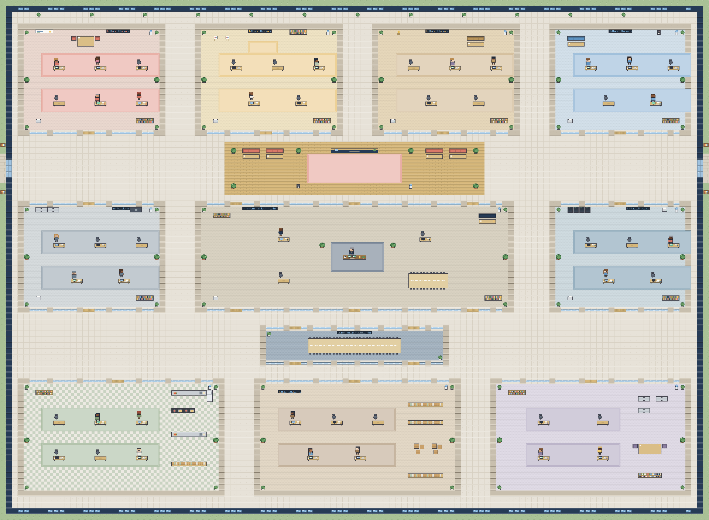

# La Goëlette — siège virtuel et entreprise pilotée par agents IA

Application web Next.js (App Router, React, TypeScript) avec un siège social explorable en pixel art 2D (Phaser 3).
Interface entièrement en français.

> **État de cette version (0.1.0)** : prototype déployable en **mode démonstration**.
> Données conservées **en mémoire** (remises à zéro à chaque redémarrage), CEO **simulé** par un planificateur à règles,
> intégration IA Anthropic **écrite mais non testée** avec une vraie clé. Voir « Limites connues ».



## Fonctionnalités

| Domaine | Ce qui fonctionne |
|---|---|
| Organisation | 10 départements, 50 postes (identifiants du cahier des charges), source unique `src/lib/organization.ts` |
| Tableau de bord | Postes, occupation, agents disponibles, exécutions réelles, missions par statut, alertes, activité, activité par département |
| Siège 2D | Carte 120 × 88 tuiles, salles, couloirs, portes, cloisons vitrées, mobilier, personnages variés, caméra, zoom, mini-carte, collisions, avatar (flèches / ZQSD / WASD, E pour interagir), modes Jeu / Gestion / Surveillance, clic sur bureau / salle / CEO, vue liste alternative (par défaut sur mobile) |
| Agents | Liste filtrable (département, état, compétence, recherche), fiche de poste complète |
| Missions | Création, filtres, affectation, transitions de statut contrôlées, commentaires, historique, export CSV |
| CEO | Saisie d'objectifs, reformulation, proposition de missions, acceptation sélective, création des missions et des demandes de validation |
| Validations | Demandes, décisions réservées au fondateur connecté, journalisation |
| Rapports / Historique | Rapports par période et département, exports CSV (missions, postes, événements), journal filtrable |
| Sécurité | Connexion fondateur (cookie signé HMAC), API agents par jeton, validation des entrées, en-têtes de sécurité |
| Agents réels | API machine : enregistrement sur un poste, début d'exécution, heartbeat, fin, demande de validation |

**Règle des états** : un poste n'est « En exécution » (personnage assis) que s'il existe une exécution identifiée, liée à une mission,
non terminée, avec un heartbeat de moins de 90 secondes. En démonstration, aucun poste n'est donc en exécution.

## Commandes

```bash
npm install        # installe les dépendances
npm run dev        # développement (http://localhost:3000)
npm run build      # compilation de production
npm run start      # démarrage de production (écoute le port fourni par la variable PORT)
npm run test       # tests unitaires et API (node:test + tsx)
npm run typecheck  # vérification TypeScript
npm run inventory  # régénère docs/agents/desk-inventory.csv
```

Node.js **20.9 ou plus** (22 recommandé).

## Déploiement Hostinger

Voir **[docs/deployment/hostinger.md](docs/deployment/hostinger.md)** (pas à pas, réglages, variables, vérifications).

En résumé : créer une **application Node.js** (et non un site web classique) depuis le dépôt GitHub, branche `main`,
répertoire racine `/`, Node 22, build `npm run build`, démarrage `npm run start`.

## Variables d'environnement

Voir `.env.example`. Aucune n'est obligatoire pour démarrer en démonstration.

| Variable | Rôle |
|---|---|
| `APP_MODE` | `demo` (défaut) ou `connected` (pas de données fictives, CEO IA si configuré) |
| `FOUNDER_PASSWORD`, `AUTH_SECRET` | Active la connexion du fondateur et protège tout le site |
| `AI_PROVIDER`, `AI_API_KEY`, `AI_MODEL` | Fournisseur IA côté serveur (`anthropic` implémenté) |
| `AGENT_API_TOKEN` | Jeton (≥ 24 caractères) des agents logiciels |
| `DATABASE_URL` | Réservée à la future persistance PostgreSQL (non utilisée dans cette version) |

## Structure

```text
src/app/            pages (Accueil, Entreprise, Siège, Départements, Agents, Missions, CEO, Rapports, Historique, Paramètres) et routes API
src/components/     interface (layout, tableau de bord, agents, missions, CEO, siège)
src/game/           siège 2D : constantes, génération de carte, pixel art généré par code, scène Phaser
src/lib/            organigramme (source unique), règles d'état, libellés
src/server/         stockage en mémoire, authentification, CEO, fournisseurs IA, utilitaires HTTP
src/types/          types métier partagés
db/schema.sql       schéma PostgreSQL cible (non branché)
docs/               architecture, design, agents, carte, déploiement
tests/              tests (organisation, carte, états, stockage, authentification, API)
```

## Limites connues

- **Persistance** : stockage en mémoire. Un redémarrage ou un redéploiement efface missions, événements et validations créés.
- **CEO** : en démonstration, planificateur à règles déterministe (présenté comme tel). L'appel Anthropic est implémenté côté serveur mais n'a pas été testé avec une vraie clé.
- **Agents spécialisés** : aucun agent IA réel n'est livré ; l'API permet d'en brancher. Les outils listés par poste sont prévus, pas connectés.
- **Siège 2D** : la logique de carte et le pixel art sont testés ; la scène Phaser n'a pas pu être exécutée dans l'environnement de développement (Phaser non installable hors ligne). À vérifier au premier déploiement.
- **Build** : `next build` n'a pas pu être exécuté pendant le développement (registre npm inaccessible). `typescript.ignoreBuildErrors` est activé par précaution dans `next.config.ts` ; à désactiver dès que `npm run typecheck` passe avec les vraies dépendances.
- **Lockfile** : `package-lock.json` sera généré au premier `npm install` ; à commiter ensuite.
- **Animations** : `idle`, `working`, `walking`, `thinking` sont animées ; `talking`, `error`, `celebrating` sont des icônes au-dessus des personnages (placeholders propres).
- **Notifications** : affichées dans l'interface uniquement (pas d'e-mail).

Les documents de conception d'origine sont conservés dans `docs/` (l'ancien README du squelette est dans `docs/legacy/`).
