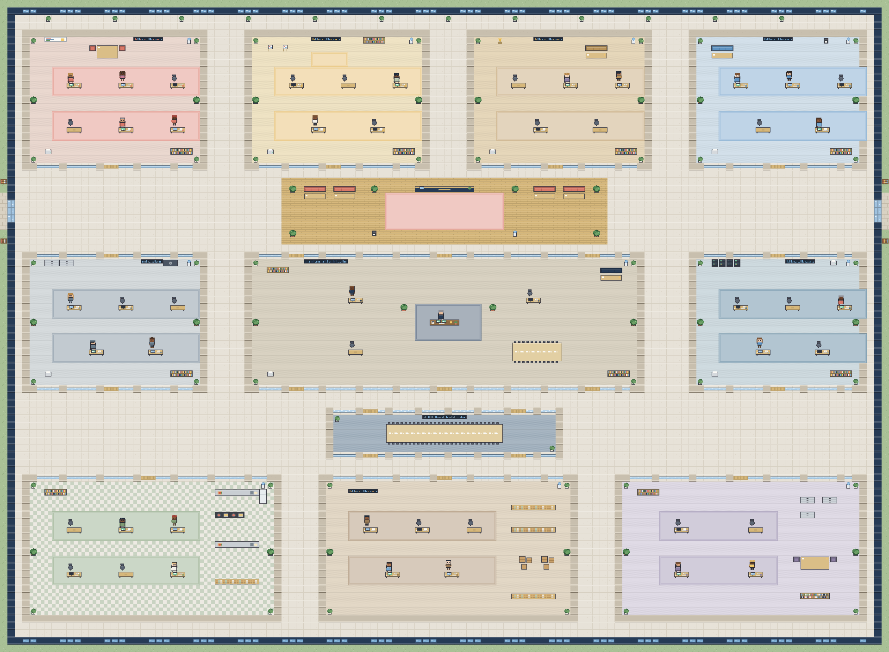

# Plan du siège

Coordonnées en tuiles (32 × 32 px), origine (0,0) en haut à gauche. Carte : 120 × 88 tuiles (3840 × 2816 px).
La carte est générée par `src/game/maps/buildMap.ts` et vérifiée par `tests/map.test.ts`
(aucun chevauchement, chaque salle a des portes accessibles, chaque bureau est accessible à pied depuis le hall).

| Salle | X | Y | Largeur | Hauteur | Postes |
|---|---:|---:|---:|---:|---:|
| Marketing | 3 | 4 | 25 | 19 | 6 |
| Création | 33 | 4 | 25 | 19 | 5 |
| Commercial | 63 | 4 | 25 | 19 | 5 |
| Expérience client | 93 | 4 | 24 | 19 | 5 |
| Finance | 3 | 34 | 25 | 19 | 5 |
| Direction | 33 | 34 | 54 | 19 | 4 |
| Informatique | 93 | 34 | 24 | 19 | 5 |
| Recherche culinaire | 3 | 64 | 35 | 20 | 6 |
| Production | 43 | 64 | 35 | 20 | 5 |
| Administration | 83 | 64 | 34 | 20 | 4 |

## Zones centrales (sans poste)

- **Hall d'accueil** : x 38–81, y 24–32, entre la rangée haute et la direction. Entrées principales à l'ouest et à l'est (y 27–29).
- **Salle de réunion** : x 44–75, y 55–61, cloisons vitrées, portes en haut et en bas.

## Circulation

- Couloirs horizontaux : y 23–33 et y 53–63 ; couloirs verticaux de 5 tuiles entre les colonnes de salles ; couloir périphérique.
- Portes de 2 tuiles au centre des murs vitrés (rangée haute : en bas ; rangée centrale : en haut et en bas ; rangée basse : en haut). La direction a trois portes par façade.

## Ajustements par rapport au cahier

- **CEO (DIR-01)** placé au centre du bâtiment (local 26,9 → tuile 59,43) avec un bureau de direction de 4 tuiles. DIR-02 (14,6), DIR-03 (38,6), DIR-04 (14,13). Identifiants et nombre de postes inchangés.
- Chaque bureau occupe 2 tuiles ; le fauteuil (et le personnage) est sur la tuile au-dessus, la tuile devant sert à l'interaction.
